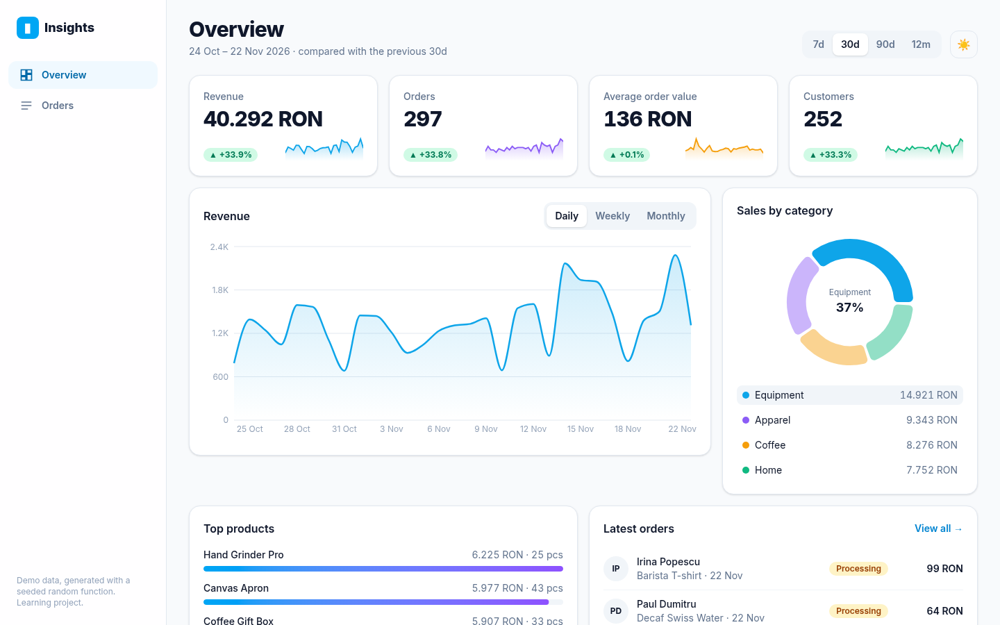
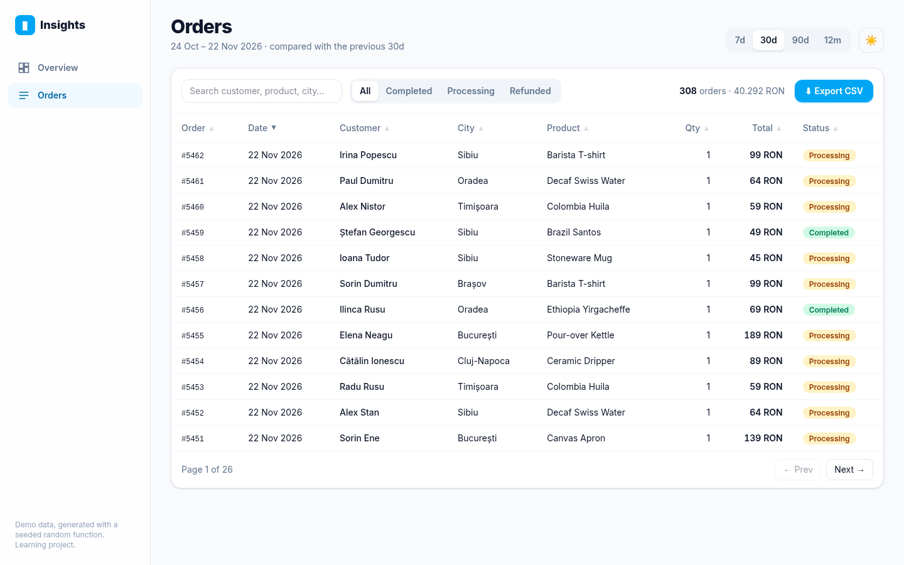
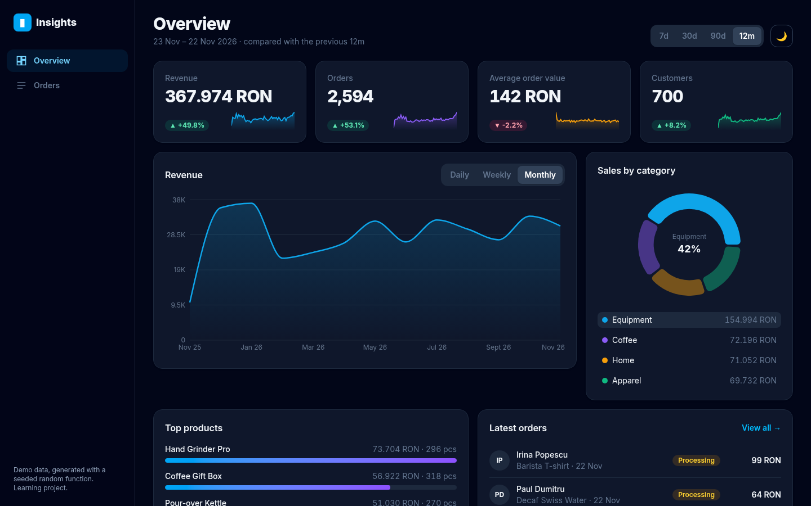
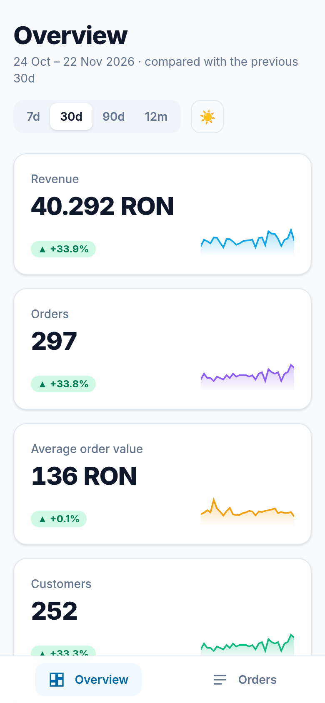

# Insights — sales analytics dashboard

An admin dashboard for a (demo) online store, built with **Next.js 15**, **TypeScript**, **Recharts**, **TanStack Table** and **Motion**.
Learning project #8 from my portfolio plan. All numbers come from a **seeded demo dataset** (about 2 years of generated orders), not from a real business.

**Live demo:** https://davidgeorgeconstantin-spec.github.io/insights-dashboard/



## Features
- **KPIs** — revenue, orders, average order value, customers, each with % change vs. the previous period and an animated sparkline
- **Date ranges** — 7 days, 30 days, 90 days, 12 months; daily / weekly / monthly grouping
- **Charts** — revenue area chart with custom tooltip, sales by category donut with hover focus, top products bars
- **Orders table** (TanStack Table) — sorting, debounced global search, status filter, pagination, live totals
- **CSV export** of the filtered rows (proper escaping + UTF-8 BOM for Excel)
- **Dark mode** with a circular reveal (View Transitions API), saved in localStorage
- **Responsive** — sidebar on desktop, bottom navigation on mobile
- **Skeleton loading** with shimmer when the range changes (simulated query latency)
- Animations: count-up numbers that roll from the old value to the new one, self-drawing sparklines, spring bars, sliding segmented controls, animated table rows and sort arrows. `prefers-reduced-motion` respected.
- Unit tests for every aggregation (Vitest), run in CI before the build

## SQL
The aggregations in `src/lib/analytics.ts` have SQL equivalents in [`sql/queries.sql`](sql/queries.sql) (`GROUP BY`, `date_trunc`, `generate_series` to fill gaps) with the schema in [`sql/schema.sql`](sql/schema.sql) — ready for PostgreSQL / Supabase.

## Stack
Next.js 15 (static export) · React 19 · TypeScript strict · Tailwind CSS 4 · Recharts 3 · TanStack Table 8 · Zustand 5 · Motion 12 · Vitest · GitHub Actions

## Structure
```
src/
├─ app/                    # / (overview), /orders
├─ components/
│  ├─ layout/              # Sidebar, Topbar, Providers
│  └─ ui/                  # Card, Segmented, Skeleton, AnimatedNumber, StatusBadge
├─ data/                   # seeded order generator
├─ features/
│  ├─ dashboard/           # Overview, KpiCard, Sparkline, RevenueChart, CategoryDonut, TopProducts, RecentOrders
│  ├─ orders/              # OrdersTable, columns, downloadCsv
│  └─ settings/            # settingsStore (range, theme), ThemeToggle
├─ hooks/                  # useDashboardData, useSimulatedLoading, useChartColors, useDebounced
├─ lib/                    # analytics (+ tests), dates, format, random
└─ types/
sql/                       # schema.sql, queries.sql
```

## Run locally
```bash
npm install
npm run dev     # http://localhost:3000/insights-dashboard
npm test        # 7 tests
npm run build   # static export to /out
```

## Deploy
`.github/workflows/deploy.yml`: lint → test → build → GitHub Pages (Settings → Pages → Source: **GitHub Actions**).

## Screenshots
| Orders | Dark mode (12 months) | Mobile |
|---|---|---|
|  |  |  |
